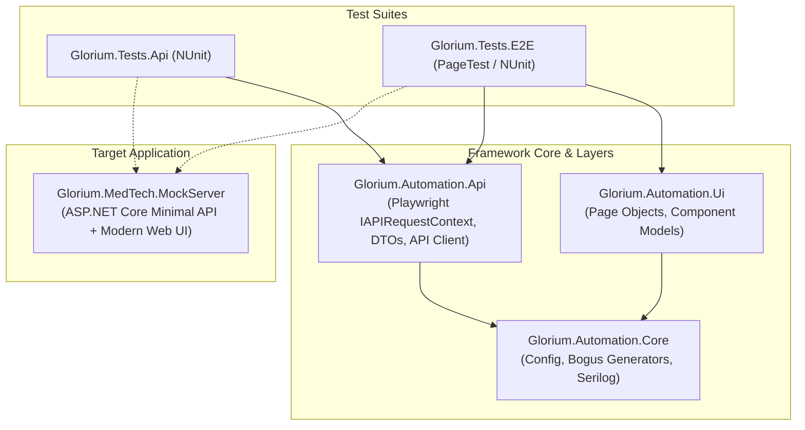

# Glorium MedTech SaaS - Automated Quality Assurance Framework

[](https://dotnet.microsoft.com/)
[](https://playwright.dev/dotnet/)
[](https://nunit.org/)
[](https://docs.gitlab.com/ee/ci/)

> Production-ready End-to-End & API Test Automation Framework designed specifically for **US Healthcare & Home Medical Equipment (DME) SaaS Platforms**. Built with **C# (.NET 8)**, **Microsoft Playwright (NUnit)**, and integrated with **GitLab CI/CD**.

---

## 🎯 Domain Context (US Healthcare / MedTech DME)

Home Medical Equipment providers and hospitals handle mission-critical, HIPAA-regulated workflows:
- **Patient Intake & Insurance Verification:** Validating demographic data and insurance coverage rules (e.g. 80% primary insurance, 20% patient copay).
- **Medical Equipment Inventory:** Tracking serialized hospital-grade devices (Oxygen Concentrators, CPAP, Bariatric Beds, Infusion Pumps).
- **Order Dispatch & Scheduling:** Coordinating delivery dates, clinician setup instructions, and real-time order status tracking.
- **SaaS Invoicing:** Automated billing generation calculating copays and insurance claims.

This repository features both **isolated API contract/functional tests** and **hybrid E2E flows** that simulate these exact business processes.

---

## 🏛️ Architecture & Clean Design



### Highlights of the Framework:
1. **Self-Contained & Reproducible:** Includes an embedded, lightweight ASP.NET Core MedTech test server (`Glorium.MedTech.MockServer`). Anyone can clone this repository and run `dotnet test` with **zero external dependencies or flaky third-party websites**.
2. **Hybrid E2E Execution:** API clients are utilized to instantly set up complex test preconditions (creating patients, registering devices) in milliseconds, allowing UI tests to focus purely on critical user interaction and verification.
3. **Flaky Test Resilience & Tracing:**
   - Strict avoidance of `Thread.Sleep` in favor of Playwright auto-waiting web assertions (`Expect(locator).ToBeVisibleAsync()`).
   - Automatic capture of **Playwright Traces (`trace.zip`)** and screenshots only on test failure.
4. **AI-Assisted Testing (`.cursorrules`):**
   - Configured coding guidelines for AI tools (Cursor, Claude, GitHub Copilot) enforcing POM standards, user-facing locators (`GetByRole`, `GetByTestId`), and HIPAA data masking.
5. **GitLab CI/CD Ready:**
   - Multi-stage pipeline (`build`, `test-api`, `test-e2e`, `report`) with a parallel browser execution matrix (Chromium, Firefox) using official Microsoft Playwright Docker images.

---

## 📂 Repository Structure

```text
├── .gitlab-ci.yml                 # Production-ready GitLab CI pipeline with JUnit reports & traces
├── .cursorrules                   # AI prompt engineering rules for Cursor & Claude
├── README.md                      # Architecture documentation & setup guide
│
├── src/
│   ├── Glorium.Automation.Core/   # Configuration, Bogus medical data generator, Serilog logging
│   ├── Glorium.Automation.Api/    # IAPIRequestContext HTTP client & MedTech DTOs
│   ├── Glorium.Automation.Ui/     # Page Objects (LoginPage, CatalogPage, OrderPage, InvoicePage)
│   └── Glorium.MedTech.MockServer/# In-memory MedTech SaaS backend & UI for 100% stable execution
│
└── tests/
    ├── Glorium.Tests.Api/         # Fast API contract & business calculation tests
    └── Glorium.Tests.E2E/         # Full end-to-end browser workflows (Playwright NUnit)
```

---

## 🚀 Getting Started

### Prerequisites
- [.NET 8.0 SDK](https://dotnet.microsoft.com/download/dotnet/8.0)

### 1. Clone & Build
```powershell
git clone https://github.com/pegasovich/glorium-medtech-qa-automation.git
cd glorium-medtech-qa-automation
dotnet build Glorium.MedTech.Automation.sln
```

### 2. Install Playwright Browsers (One-time)
```powershell
powershell tests/Glorium.Tests.E2E/bin/Debug/net8.0/playwright.ps1 install chromium
```

### 3. Run All Tests
```powershell
# Run API tests
dotnet test tests/Glorium.Tests.Api

# Run E2E Playwright tests
dotnet test tests/Glorium.Tests.E2E

# Run all tests with detailed console logs
dotnet test --logger:"console;verbosity=normal"
```

---

## 🔍 Post-Mortem Debugging with Playwright Trace Viewer

When a test fails, a full diagnostic trace is automatically saved in `playwright-traces/`. You can inspect the DOM, console logs, network calls, and execution timeline:

```powershell
powershell tests/Glorium.Tests.E2E/bin/Debug/net8.0/playwright.ps1 show-trace playwright-traces/<TestName>-trace.zip
```
*(Or drag and drop the `.zip` file into [trace.playwright.dev](https://trace.playwright.dev))*

---

## ⚙️ CI/CD Pipeline (GitLab CI)

The `.gitlab-ci.yml` pipeline runs inside the official `mcr.microsoft.com/playwright/dotnet:v1.49.0-jammy` container and executes:
1. **`build`**: Restores NuGet dependencies and compiles solution with `--configuration Release`.
2. **`test-api`**: Executes fast contract tests and produces `JUnit` test reports for GitLab MR widgets.
3. **`test-e2e`**: Runs browser tests in parallel across **Chromium** and **Firefox**, attaching traces and screenshots on failures.
4. **`report`**: Publishes execution artifacts to GitLab Pages.

---

## 💡 Key Talking Points for Technical Interviews

- **Why C# + Playwright + NUnit?**
  * Microsoft officially develops and maintains the `Microsoft.Playwright.NUnit` package with first-class `PageTest` fixtures, parallel worker isolation, and built-in locator assertions.
- **Why Hybrid E2E instead of Pure UI?**
  * Setting up test data (patients, hospital beds) via UI creates slow, brittle tests. Generating data via API requests reduces test execution time from minutes to seconds while preserving 100% E2E fidelity of the checkout and order flow.
- **How do you handle Flakiness?**
  * Auto-waiting locators, test retries in CI, strict data isolation via Bogus fakers, and recording Playwright Traces for deterministic root-cause analysis.
- **How do you leverage AI tools (Cursor / Claude)?**
  * Using repository-specific `.cursorrules` to instruct the AI to follow POM conventions, favor accessible user-facing locators (`GetByRole`), and write self-documenting AAA tests.

